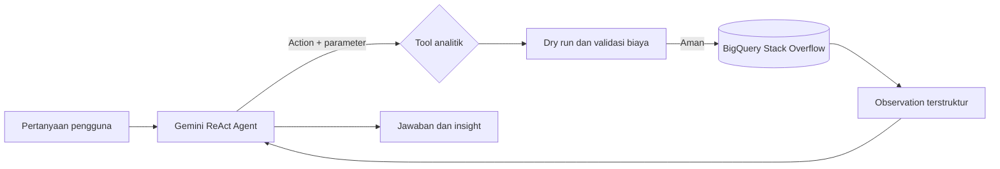
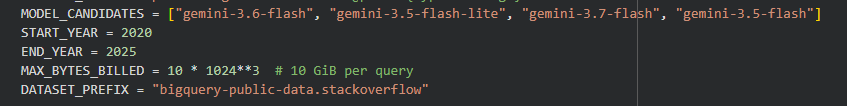
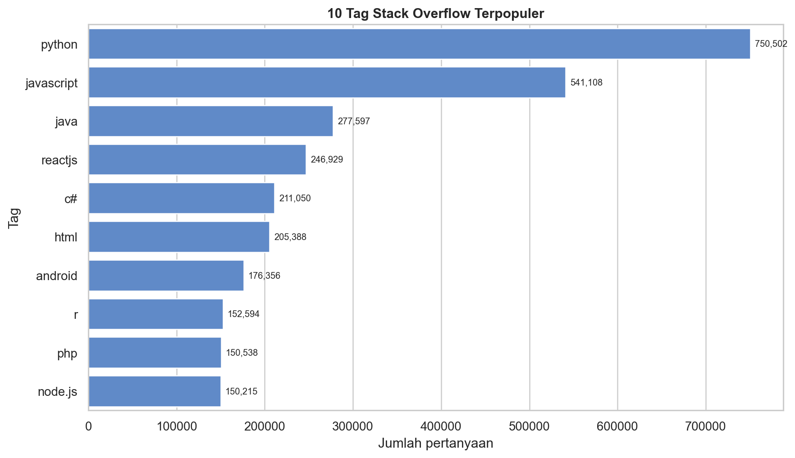
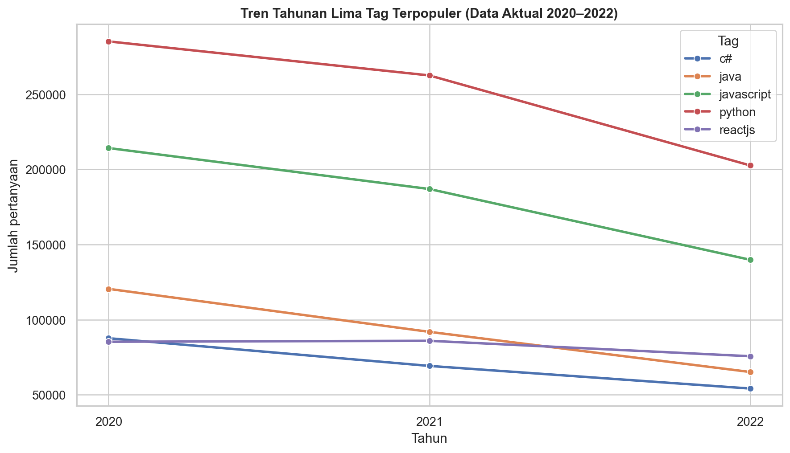
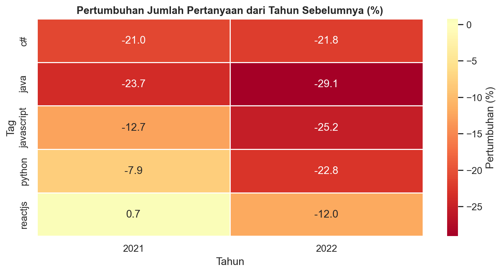
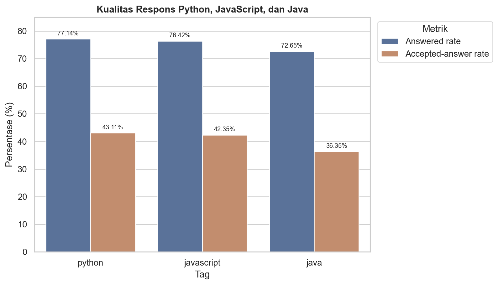

# Data Analytics ReAct Agent: Tren Teknologi Stack Overflow 2020–2025

**Nama:** [Isi nama]  
**Kelas:** [Isi kelas]  
**Tanggal:** [Isi tanggal]

## 1. Tujuan proyek

Proyek ini membangun Data Analytics ReAct Agent yang mampu menerjemahkan pertanyaan bahasa alami menjadi tindakan analitik terkontrol pada Google BigQuery. Tujuan analisisnya adalah mengidentifikasi teknologi yang paling banyak dibahas, perubahan popularitasnya selama 2020–2025, serta kualitas respons komunitas berdasarkan jumlah jawaban, accepted answer, skor, dan view.

## 2. Dataset

Data berasal dari Google BigQuery Public Dataset `bigquery-public-data.stackoverflow`, terutama tabel `posts_questions`. Unit analisis adalah pertanyaan Stack Overflow. Kolom utama yang digunakan meliputi waktu pembuatan, tag, jumlah jawaban, accepted answer, skor, dan jumlah view.

Query menggunakan filter 1 Januari 2020 sampai 31 Desember 2025. Namun, hasil aktual hanya memuat observasi 2020–2022. Karena jumlah per tag pada data tren 2020–2022 sama persis dengan total pada hasil top tags, pembahasan tren dibatasi pada cakupan data aktual 2020–2022. Tahun 2023–2025 tidak dianggap bernilai nol; periode tersebut tidak tersedia pada hasil dataset saat notebook dijalankan.

## 3. Arsitektur dan alur ReAct



Agent menggunakan function calling dari Gemini dengan Gemini 3.6 Flash sebagai model utama dan model Gemini 3 lain sebagai fallback. Model memilih satu atau beberapa tool berdasarkan pertanyaan, sedangkan Python mengendalikan query yang boleh dijalankan. Audit trail hanya menampilkan action, parameter, status query, dan observation; penalaran internal model tidak ditampilkan.

### 3.1 Model yang digunakan

| Urutan | Model | Peran |
|---:|---|---|
| 1 | `gemini-3.6-flash` | Model utama untuk memahami pertanyaan dan memilih tool. |
| 2 | `gemini-3.5-flash-lite` | Fallback berlatensi rendah ketika model utama sibuk atau kuotanya tidak tersedia. |
| 3 | `gemini-3.7-flash` | Fallback untuk reasoning dan workflow agentik yang lebih kompleks. |
| 4 | `gemini-3.5-flash` | Fallback terakhir. |

Pada eksekusi yang didokumentasikan, `gemini-3.6-flash` sedang tidak tersedia sehingga agent berhasil menggunakan **`gemini-3.5-flash-lite`**. Model Gemini tidak menghitung agregasi sendiri. Perhitungannya dilakukan oleh BigQuery melalui tool Python, sedangkan model bertugas memilih action, membaca observation, dan menyusun penjelasan.



*Gambar 1. Konfigurasi model fallback, periode analisis, batas query, dan dataset.*

Tool yang tersedia:

1. `get_top_tags`: memperoleh tag paling populer pada suatu periode.
2. `get_tag_trend`: melihat tren tahunan sebuah tag.
3. `compare_tags`: membandingkan beberapa tag per tahun.
4. `get_answer_rate`: mengukur engagement dan kualitas respons beberapa tag.

### 3.2 Kode penting

Berikut potongan kode utama yang menunjukkan konfigurasi, pengendalian query, pemanggilan agent, dan ekspor hasil. Kode lengkap tersedia pada notebook.

#### Konfigurasi koneksi dan model

```python
PROJECT_ID = ""  # diisi dengan project ID Google Cloud
MODEL_CANDIDATES = [
    "gemini-3.6-flash",
    "gemini-3.5-flash-lite",
    "gemini-3.7-flash",
    "gemini-3.5-flash",
]
START_YEAR, END_YEAR = 2020, 2025
MAX_BYTES_BILLED = 10 * 1024**3  # 10 GiB per query
DATASET_PREFIX = "bigquery-public-data.stackoverflow"

from google import genai
from google.cloud import bigquery

bq_client = bigquery.Client(project=PROJECT_ID)
gemini_client = genai.Client(api_key=GEMINI_API_KEY)
```

`GEMINI_API_KEY` dibaca dari Colab Secrets dengan `userdata.get("GEMINI_API_KEY")`, bukan ditulis langsung di notebook.

#### Validasi, dry run, dan batas biaya

```python
def _run_safe_query(sql, query_parameters, action, params):
    cache_key = json.dumps({"action": action, "params": params}, sort_keys=True)
    if cache_key in QUERY_CACHE:
        df = QUERY_CACHE[cache_key].copy()
        AUDIT_LOG.append({"action": action, "status": "cache_hit", "rows": len(df)})
        return df

    normalized = re.sub(r"\s+", " ", sql).strip().lower()
    if not normalized.startswith("select"):
        raise ValueError("Hanya query SELECT yang diizinkan.")
    if f"`{DATASET_PREFIX}." not in sql:
        raise ValueError("Query hanya boleh membaca dataset publik yang ditentukan.")

    dry_config = bigquery.QueryJobConfig(
        dry_run=True, use_query_cache=False, query_parameters=query_parameters
    )
    dry_job = bq_client.query(sql, job_config=dry_config)
    estimated = int(dry_job.total_bytes_processed or 0)
    if estimated > MAX_BYTES_BILLED:
        raise RuntimeError("Query diblokir karena melewati batas biaya.")

    run_config = bigquery.QueryJobConfig(
        maximum_bytes_billed=MAX_BYTES_BILLED,
        query_parameters=query_parameters,
    )
    df = bq_client.query(sql, job_config=run_config).result().to_dataframe()
    QUERY_CACHE[cache_key] = df.copy()
    AUDIT_LOG.append({"action": action, "status": "success", "rows": len(df)})
    return df
```

#### Tool analitik berbasis parameter

```python
def get_top_tags(start_year=2020, end_year=2025, limit=10):
    start_year, end_year = _validate_years(start_year, end_year)
    sql = f"""
    SELECT tag, COUNT(*) AS question_count
    FROM `{DATASET_PREFIX}.posts_questions` AS q
    CROSS JOIN UNNEST(SPLIT(q.tags, '|')) AS tag
    WHERE q.creation_date >= TIMESTAMP(@start_date)
      AND q.creation_date < TIMESTAMP(@end_date)
      AND tag != ''
    GROUP BY tag
    ORDER BY question_count DESC, tag
    LIMIT @row_limit
    """
    parameters = [
        bigquery.ScalarQueryParameter("start_date", "DATE", date(start_year, 1, 1)),
        bigquery.ScalarQueryParameter("end_date", "DATE", date(end_year + 1, 1, 1)),
        bigquery.ScalarQueryParameter("row_limit", "INT64", int(limit)),
    ]
    return _observation(
        "get_top_tags",
        _run_safe_query(sql, parameters, "get_top_tags", {
            "start_year": start_year, "end_year": end_year, "limit": limit
        }),
    )

ANALYTIC_TOOLS = [get_top_tags, get_tag_trend, compare_tags, get_answer_rate]
```

#### Pemanggilan ReAct agent dan fallback model

```python
for model_id in MODEL_CANDIDATES:
    try:
        chat = gemini_client.chats.create(
            model=model_id,
            config=types.GenerateContentConfig(
                system_instruction=SYSTEM_INSTRUCTION,
                tools=ANALYTIC_TOOLS,
            ),
        )
        response = chat.send_message(question.strip())
        selected_model = model_id
        break
    except (errors.ClientError, errors.ServerError) as exc:
        # 404, 429, 503, dan 504 ditangani dengan mencoba model berikutnya.
        last_error = exc
```

#### Ekspor hasil dan audit trail

```python
for result_name, result_df in LAST_RESULTS.items():
    result_df.to_csv(f"hasil_{result_name}.csv", index=False)

with open("audit_trail.json", "w", encoding="utf-8") as file:
    json.dump(AUDIT_LOG, file, ensure_ascii=False, indent=2, default=str)
```

### 3.3 Pertanyaan utama dan respons agent

Model utama `gemini-3.6-flash` sedang tidak tersedia, sehingga sistem melanjutkan proses menggunakan `gemini-3.5-flash-lite`.

#### Pertanyaan

> Di antara lima tag teknologi dengan jumlah pertanyaan terbanyak di Stack Overflow selama 2020–2025, tag mana yang mengalami kenaikan atau penurunan paling besar, dan bagaimana perbandingan kualitas respons komunitasnya berdasarkan answered rate, accepted-answer rate, rata-rata skor, dan rata-rata jumlah view?
>
> Gunakan beberapa tool yang diperlukan, sebutkan angka aktual, dan jangan menganggap jumlah pertanyaan Stack Overflow sebagai tingkat adopsi teknologi di industri.

#### Audit trail

```text
1. {"action": "get_top_tags", "parameters": {"start_year": 2020, "end_year": 2025, "limit": 5}, "status": "cache_hit", "rows": 5}
2. {"action": "get_top_tags", "parameters": {"start_year": 2020, "end_year": 2025, "limit": 5}, "status": "cache_hit", "rows": 5}
3. {"action": "compare_tags", "parameters": {"tags": ["python", "javascript", "java", "reactjs", "c#"], "start_year": 2020, "end_year": 2025}, "status": "cache_hit", "rows": 15}
4. {"action": "get_answer_rate", "parameters": {"tags": ["python", "javascript", "java", "reactjs", "c#"], "start_year": 2020, "end_year": 2025}, "status": "cache_hit", "rows": 5}
5. {"action": "get_tag_trend", "parameters": {"tag": "python", "start_year": 2020, "end_year": 2025}, "status": "cache_hit", "rows": 3}
6. {"action": "get_tag_trend", "parameters": {"tag": "javascript", "start_year": 2020, "end_year": 2025}, "estimated_bytes": 817706334, "status": "success", "rows": 3}
7. {"action": "get_tag_trend", "parameters": {"tag": "java", "start_year": 2020, "end_year": 2025}, "estimated_bytes": 817706334, "status": "success", "rows": 3}
8. {"action": "get_tag_trend", "parameters": {"tag": "reactjs", "start_year": 2020, "end_year": 2025}, "estimated_bytes": 817706334, "status": "success", "rows": 3}
9. {"action": "get_tag_trend", "parameters": {"tag": "c#", "start_year": 2020, "end_year": 2025}, "estimated_bytes": 817706334, "status": "success", "rows": 3}
```

#### Jawaban agent

##### Temuan

Berdasarkan data Stack Overflow periode 2020–2025, lima tag dengan jumlah pertanyaan terbanyak adalah **Python** (750.502), **JavaScript** (541.108), **Java** (277.597), **ReactJS** (246.929), dan **C#** (211.050).

1. **Tren volume pertanyaan (2020–2022)**

   - **Penurunan terbesar secara absolut:** Python mengalami penurunan volume mutlak terbesar, dari 285.228 pertanyaan pada 2020 menjadi 202.689 pertanyaan pada 2022, atau turun 82.539 pertanyaan. JavaScript menyusul dengan penurunan dari 214.248 menjadi 139.880, atau turun 74.368 pertanyaan.
   - **Penurunan terbesar secara persentase:** Java mengalami penurunan paling tajam, dari 120.509 pada 2020 menjadi 65.190 pada 2022, atau sekitar 45,90%. ReactJS relatif stabil pada awal periode, dari 85.310 pada 2020 menjadi 85.945 pada 2021, kemudian turun menjadi 75.674 pada 2022. Perubahan total ReactJS sekitar -11,30%.

2. **Perbandingan kualitas respons komunitas**

   - **Answered rate:** Python 77,14%; JavaScript 76,42%; ReactJS 74,51%; C# 73,86%; dan Java 72,65%.
   - **Accepted-answer rate:** Python 43,11%; JavaScript 42,35%; C# 40,83%; ReactJS 38,71%; dan Java 36,35%.
   - **Rata-rata skor:** ReactJS 0,68; JavaScript 0,45; Python 0,42; Java 0,41; dan C# 0,38.
   - **Rata-rata view:** ReactJS 735,49; JavaScript 435,28; Java 422,57; Python 413,27; dan C# 380,98 view per pertanyaan.

##### Interpretasi

- Aktivitas diskusi Stack Overflow, seperti volume pertanyaan, skor, dan view, merefleksikan dinamika pencarian solusi oleh pengembang dan bukan tingkat adopsi teknologi secara keseluruhan di industri.
- Python dan JavaScript mendominasi volume diskusi pada data yang dianalisis.
- ReactJS menunjukkan visibilitas dan engagement per pertanyaan yang tinggi berdasarkan rata-rata view dan skor tertinggi.
- Dugaan bahwa penurunan pertanyaan dipengaruhi AI assistant atau sumber dokumentasi alternatif merupakan hipotesis, bukan kesimpulan yang dapat dibuktikan oleh dataset ini.

##### Keterbatasan

- Data tren tahunan yang dikembalikan tool hanya tersedia sampai 2022, sehingga perbandingan tren menggunakan 2020–2022.
- Answered rate dan accepted-answer rate bergantung pada perilaku pengguna dalam menjawab dan menandai accepted answer.
- Hasil bersifat deskriptif dan tidak membuktikan hubungan sebab-akibat.

### 3.4 Contoh pertanyaan interaktif dan respons

Model utama `gemini-3.6-flash` kembali tidak tersedia dan pertanyaan diselesaikan oleh `gemini-3.5-flash-lite`.

#### Pertanyaan

> Bandingkan kualitas respons komunitas untuk tag Python, JavaScript, dan Java selama 2020–2025 berdasarkan answered rate, accepted-answer rate, rata-rata skor, dan rata-rata view.

#### Audit trail

```text
1. {"action": "get_answer_rate", "parameters": {"tags": ["python", "javascript", "java"], "start_year": 2020, "end_year": 2025}, "status": "cache_hit", "rows": 3}
2. {"action": "get_answer_rate", "parameters": {"tags": ["python", "javascript", "java"], "start_year": 2020, "end_year": 2025}, "status": "cache_hit", "rows": 3}
```

#### Jawaban agent

##### Temuan

- **Python** — 750.502 pertanyaan; answered rate 77,14%; accepted-answer rate 43,11%; rata-rata skor 0,42; dan rata-rata view 413,27.
- **JavaScript** — 541.108 pertanyaan; answered rate 76,42%; accepted-answer rate 42,35%; rata-rata skor 0,45; dan rata-rata view 435,28.
- **Java** — 277.597 pertanyaan; answered rate 72,65%; accepted-answer rate 36,35%; rata-rata skor 0,41; dan rata-rata view 422,57.

##### Interpretasi

1. Python dan JavaScript menunjukkan tingkat respons yang hampir sama dan relatif tinggi. Answered rate keduanya berada pada kisaran 76%–77%, sedangkan accepted-answer rate berada pada kisaran 42%–43%.
2. Java memiliki answered rate dan accepted-answer rate yang lebih rendah daripada Python dan JavaScript.
3. Ketiga bahasa mempunyai rata-rata skor yang berdekatan, yaitu 0,41–0,45, serta rata-rata view sekitar 413–435.
4. Perbedaan tersebut menggambarkan dinamika diskusi dan ketersediaan kontributor di Stack Overflow, bukan tingkat adopsi teknologi di industri.

##### Keterbatasan

- Data hanya merepresentasikan aktivitas tanya-jawab di Stack Overflow, bukan seluruh ekosistem pengembang.
- Metrik kualitas diagregasikan untuk keseluruhan periode dan tidak memperlihatkan fluktuasi kualitas respons per tahun.

## 4. Pengendalian keamanan dan biaya

Parameter tahun, nama tag, dan jumlah hasil divalidasi sebelum query. Semua query harus berupa `SELECT`, hanya mengakses dataset publik yang ditentukan, menjalani dry run, dan mematuhi batas default 10 GB per query. `LIMIT` tidak digunakan sebagai satu-satunya kontrol biaya karena tidak selalu mengurangi jumlah byte yang diproses.

## 5. Cara menjalankan

1. Buka `stackoverflow_react_agent.ipynb` di Google Colab.
2. Isi `PROJECT_ID` dan simpan `GEMINI_API_KEY` di Colab Secrets.
3. Jalankan semua sel secara berurutan.
4. Pastikan pemeriksaan koneksi dan schema berhasil.
5. Jalankan prompt demo serta sel visualisasi.
6. Salin tabel, grafik, audit trail, dan jawaban agent yang relevan ke bagian hasil berikut.

Tautan proyek:

- [Notebook Google Colab](https://colab.research.google.com/drive/1cqoW4A2ZaIjj_SJSc7OD04zMLxX2hsWr?usp=sharing)
- [Posting LinkedIn](https://lnkd.in/p/gNApH9bS)

## 6. Hasil analisis

Hasil berikut berasal dari file CSV yang diekspor pada 3 September 2026. Seluruh angka merupakan output aktual BigQuery, bukan angka contoh.

### 6.1 Tag paling populer

| Peringkat | Tag | Jumlah pertanyaan |
|---:|---|---:|
| 1 | python | 750.502 |
| 2 | javascript | 541.108 |
| 3 | java | 277.597 |
| 4 | reactjs | 246.929 |
| 5 | c# | 211.050 |
| 6 | html | 205.388 |
| 7 | android | 176.356 |
| 8 | r | 152.594 |
| 9 | php | 150.538 |
| 10 | node.js | 150.215 |

Python merupakan tag dengan jumlah pertanyaan terbesar, sekitar 1,39 kali JavaScript dan 2,70 kali Java. Peringkat ini menggambarkan intensitas diskusi pada Stack Overflow, bukan secara langsung pangsa pasar atau adopsi teknologi di industri.



*Gambar 2. Sepuluh tag Stack Overflow dengan jumlah pertanyaan terbanyak pada hasil query.*

### 6.2 Perubahan tren pada cakupan data 2020–2022

| Tag | 2020 | 2021 | 2022 | Perubahan 2020–2022 |
|---|---:|---:|---:|---:|
| python | 285.228 | 262.585 | 202.689 | -28,94% |
| javascript | 214.248 | 186.980 | 139.880 | -34,71% |
| java | 120.509 | 91.898 | 65.190 | -45,90% |
| c# | 87.658 | 69.226 | 54.166 | -38,21% |
| reactjs | 85.310 | 85.945 | 75.674 | -11,30% |

Semua tag berakhir lebih rendah pada 2022 dibandingkan 2020. Java mengalami penurunan relatif terbesar, yaitu 45,90%, sedangkan ReactJS paling bertahan dengan penurunan 11,30%. ReactJS bahkan naik tipis 0,74% pada 2021 sebelum turun 11,95% pada 2022. Penurunan ini tidak cukup untuk menyimpulkan bahwa penggunaan teknologi tersebut di industri menurun karena metrik hanya mengukur jumlah pertanyaan di Stack Overflow.



*Gambar 3. Jumlah pertanyaan tahunan lima tag utama pada cakupan data aktual 2020–2022.*



*Gambar 4. Persentase perubahan jumlah pertanyaan dari tahun sebelumnya.*

### 6.3 Kualitas respons komunitas

File kualitas respons terakhir mencakup Python, JavaScript, dan Java.

| Tag | Pertanyaan | Answered rate | Accepted-answer rate | Rata-rata jawaban | Rata-rata skor | Rata-rata view |
|---|---:|---:|---:|---:|---:|---:|
| python | 750.502 | 77,14% | 43,11% | 1,12 | 0,42 | 413,27 |
| javascript | 541.108 | 76,42% | 42,35% | 1,15 | 0,45 | 435,28 |
| java | 277.597 | 72,65% | 36,35% | 1,03 | 0,41 | 422,57 |

Python memiliki answered rate dan accepted-answer rate tertinggi di antara tiga tag. JavaScript memiliki rata-rata jawaban, skor, dan view tertinggi, walaupun selisih answered rate terhadap Python hanya 0,72 poin persentase. Java memiliki nilai terendah pada answered rate, accepted-answer rate, rata-rata jawaban, dan rata-rata skor. Metrik ini bersifat deskriptif dan tidak membuktikan bahwa bahasa pemrograman tertentu menyebabkan kualitas respons yang lebih baik.



*Gambar 5. Perbandingan answered rate dan accepted-answer rate dari file ekspor interaktif.*

### 6.4 Contoh jejak ReAct

Audit trail prompt utama pada transkrip di Bagian 3.2 mencatat sembilan action/observation:

1. Dua pemanggilan `get_top_tags` untuk menentukan lima tag utama.
2. Satu pemanggilan `compare_tags` untuk membandingkan tren tahunan.
3. Satu pemanggilan `get_answer_rate` untuk mengukur kualitas respons lima tag.
4. Lima pemanggilan `get_tag_trend` untuk memeriksa tren setiap tag secara individual.

Beberapa action berstatus `cache_hit`, yang berarti hasil query identik digunakan kembali tanpa mengulang pemrosesan BigQuery. Pemanggilan tren yang dieksekusi memiliki estimasi sekitar 817.706.334 byte per query dan berstatus `success`.

File `audit_trail.json` yang diekspor setelah pertanyaan interaktif mencatat:

- **Action:** `get_answer_rate`
- **Parameter:** tag Python, JavaScript, dan Java; tahun awal 2020; tahun akhir 2025
- **Dry-run estimate:** 1.464.231.622 byte, sekitar 1,36 GiB
- **Status:** berhasil
- **Observation:** tiga baris hasil kualitas respons

Kedua bukti tersebut menunjukkan bahwa agent menjalankan tool terkontrol dan query tetap berada di bawah batas 10 GiB.

## 7. Kesimpulan dan insight

1. Python mendominasi aktivitas diskusi dengan 750.502 pertanyaan pada data yang tersedia, diikuti JavaScript dengan 541.108 pertanyaan.
2. Kelima tag utama menurun dari 2020 ke 2022. Java mencatat penurunan relatif terbesar sebesar 45,90%, sementara ReactJS paling stabil dengan penurunan 11,30%.
3. Pada tiga tag yang dianalisis kualitasnya, Python memiliki answered rate tertinggi sebesar 77,14% dan accepted-answer rate tertinggi sebesar 43,11%.
4. JavaScript menghasilkan engagement rata-rata tertinggi: 1,15 jawaban, skor 0,45, dan 435,28 view per pertanyaan.
5. Temuan hanya menggambarkan aktivitas dan respons di Stack Overflow. Data ini tidak cukup untuk menyimpulkan tingkat adopsi industri maupun penyebab perubahan jumlah pertanyaan.

## 8. Keterbatasan

- Jumlah pertanyaan tidak sama dengan tingkat penggunaan teknologi di industri.
- Satu pertanyaan dapat memiliki beberapa tag sehingga agregasi antartag tidak bersifat saling eksklusif.
- Data dapat berubah ketika dataset publik Stack Overflow diperbarui.
- Accepted-answer rate dipengaruhi perilaku penanya, bukan hanya kualitas jawaban.
- Analisis ini bersifat deskriptif dan tidak membuktikan hubungan sebab-akibat.

## 9. Pembelajaran

Proyek ini menunjukkan bahwa ReAct Agent memerlukan pemisahan yang jelas antara keputusan model dan eksekusi data. Gemini memilih action dan parameternya, sementara fungsi Python memvalidasi rentang tahun, tag, jenis query, dataset tujuan, serta biaya sebelum BigQuery dijalankan. Dry run membuat estimasi pemrosesan dapat diaudit sebelum query aktual. Observation terstruktur kemudian menjadi dasar jawaban model sehingga insight dapat ditelusuri kembali ke data. Proses validasi manual juga penting: total Python sebesar 750.502 pada query kontrol sama dengan hasil tool, sehingga agregasi utama terkonfirmasi konsisten.

## 10. Referensi

- Google Cloud, BigQuery Public Datasets: https://cloud.google.com/bigquery/public-data
- Google Cloud, Running Queries and Dry Runs: https://cloud.google.com/bigquery/docs/running-queries
- Google Cloud, BigQuery Cost Best Practices: https://cloud.google.com/bigquery/docs/best-practices-costs
- Google AI, Gemini Function Calling: https://ai.google.dev/gemini-api/docs/function-calling
- Stack Overflow Public Data: https://stackoverflow.com/help/data-dumps
