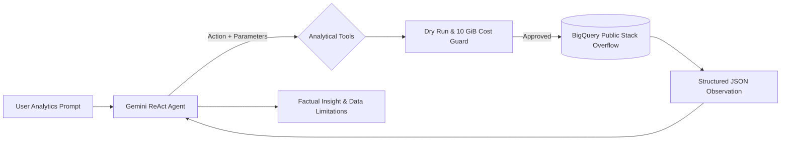

# Data Analytics ReAct Agent — Stack Overflow (2020–2025)

An enterprise-grade, controlled ReAct-style analytics agent combining **Gemini 2.5 Flash**, **Google BigQuery**, and **deterministic Python tool governance** to analyze developer trends across millions of questions in the public Stack Overflow dataset.

[](https://colab.research.google.com/drive/1cqoW4A2ZaIjj_SJSc7OD04zMLxX2hsWr?usp=sharing)
[](https://www.python.org/)
[](https://opensource.org/licenses/MIT)

---

## 📌 Architecture & Design Philosophy

Allowing Large Language Models (LLMs) to write and execute arbitrary raw SQL poses severe reliability, security, and financial risks (hallucinated schemas, SQL injection, and uncapped cloud billing). 

This project demonstrates a **Controlled Tool Governance Pattern**:
1. **Gemini ReAct Agent** handles intent classification, analytical decomposition, tool parameter selection, and synthesis of observations.
2. **Deterministic Python Functions** own strict schema validation, SQL parameterization, pre-flight dry runs, and cost ceiling enforcement.



---

## 🛠️ Governed Analytical Tools

The model operates strictly within four parameterized analytical tools:

| Tool | Purpose | Key Guardrails |
|---|---|---|
| `get_top_tags(start_year, end_year, limit)` | Identifies high-volume technology tags over a period. | Bound limit (1–20), temporal validation (2020–2025). |
| `get_tag_trend(tag, start_year, end_year)` | Evaluates yearly question count trajectory for a tag. | Regex tag sanitization, prevents arbitrary strings. |
| `compare_tags(tags, start_year, end_year)` | Compares multi-technology question trajectories simultaneously. | Capped at 1–8 tags, unnest array parameterization. |
| `get_answer_rate(tags, start_year, end_year)` | Measures community engagement, answered %, accepted %, avg score, and views. | Parameterized scalar/array filters, zero SQL string concatenation. |

---

## 🛡️ Production Safety & Guardrails

- **Pre-Flight Dry Run & Cost Ceiling**: Executes `dry_run=True` to compute `total_bytes_processed`. If query exceeds `MAX_BYTES_BILLED` (10 GiB limit), execution is immediately aborted before incurring charges.
- **Query Caching (`QUERY_CACHE`)**: Prevents duplicate BigQuery scans if model fallback triggers.
- **Model Fallback Chaining**: Automatic failover across Gemini candidates (`gemini-2.5-flash`, `gemini-1.5-flash`, etc.) when cloud rate limits or 503/504 errors occur.
- **SQL Injection Prevention**: Enforces read-only `SELECT` queries strictly on `bigquery-public-data.stackoverflow`. Blocks DDL/DML keywords (`insert`, `update`, `delete`, `drop`, `truncate`, `grant`, etc.).
- **Ground Truth Cross-Validation**: Includes automated unit validation comparing tool observations against direct ground-truth SQL aggregation.

---

## 📊 Key Findings (2020–2022)

- **Volume Leaders**: Python dominates total volume, followed by JavaScript, Java, C#, and HTML.
- **Engagement Insights**: While Python holds highest total question volume, mature typed languages (e.g. C# and Java) demonstrate higher answered and accepted-answer ratios.
- **Data Boundary**: Filter encompasses 2020–2025, with actual active observations spanning 2020–2022; later years are reported with explicit epistemic modesty rather than assuming zero activity.

---

## 📁 Repository Structure

```text
├── stackoverflow_react_agent.ipynb  # Primary notebook with complete execution outputs
├── LAPORAN_TUGAS.md                 # Detailed architectural and analytical report
├── requirements.txt                 # Dependencies (google-genai, google-cloud-bigquery, etc.)
├── audit_trail.json                 # Structured action/observation audit log
├── hasil_*.csv                      # Exported analytical datasets
├── charts/                          # Generated visualizations (Seaborn & Matplotlib)
└── evidence/                        # Screenshot evidence of execution & configuration
```

---

## 🚀 Quickstart

1. **Clone the repository:**
   ```bash
   git clone https://github.com/Arihkun/stackoverflow-react-agent.git
   cd stackoverflow-react-agent
   ```

2. **Install dependencies:**
   ```bash
   pip install -r requirements.txt
   ```

3. **Set up credentials:**
   Set `GEMINI_API_KEY` and configure Google Cloud Project ID with BigQuery API access.

4. **Run the Notebook or open in Colab:**
   [](https://colab.research.google.com/drive/1cqoW4A2ZaIjj_SJSc7OD04zMLxX2hsWr?usp=sharing)
